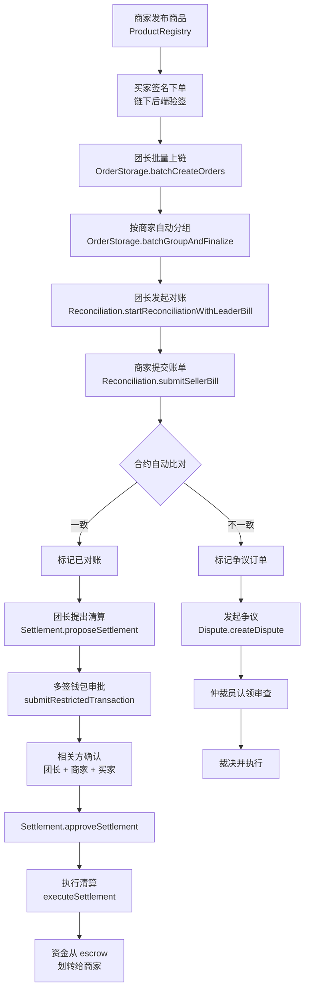
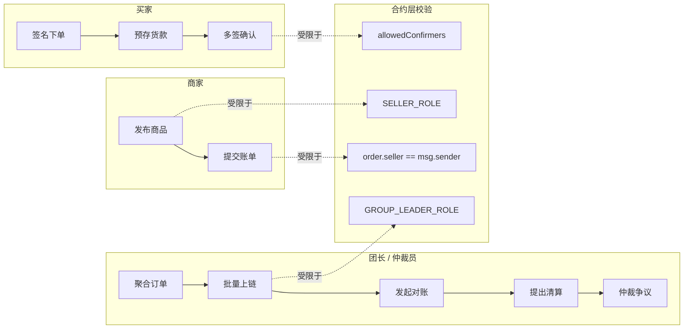
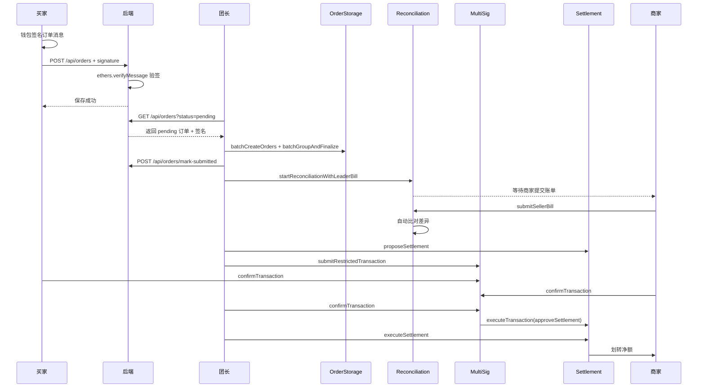

# 基于智能合约多签的社区团购多方对账与净额清算系统

> **Community Group Buying Multi-party Reconciliation & Net Settlement System based on Smart Contract Multi-signature**

---

## 目录

- [项目概述](#项目概述)
- [研究背景与意义](#研究背景与意义)
- [系统架构](#系统架构)
- [系统流程图](#系统流程图)
- [核心创新点](#核心创新点)
- [技术选型分析](#技术选型分析)
- [智能合约设计](#智能合约设计)
- [业务流程](#业务流程)
- [安全机制](#安全机制)
- [快速开始](#快速开始)
- [项目结构](#项目结构)
- [答辩说明](#答辩说明)
- [当前不足与后续改进](#当前不足与后续改进)

---

## 项目概述

本系统是一个基于以太坊智能合约的社区团购多方对账与净额清算平台，通过**多签钱包**保护资金安全，**批量对账**确认交易，**净额清算**最大化资金效率，**争议状态机**保障交易公平。系统将传统社区团购中依赖中心化平台的信任问题，转化为基于智能合约的可验证、可追溯、不可篡改的链上流程。

### 核心能力

| 能力 | 描述 |
|------|------|
| 🔐 多签资金保护 | N-of-M 多签钱包，防止单点作恶 |
| 📊 批量对账确认 | 订单按批次分组对账，支持争议订单排除 |
| 💰 净额清算 | 计算各参与方净额头寸，仅支付净额为正的参与方 |
| ⚖️ 争议状态机 | Open → UnderReview → Resolved → Executed 四阶段闭环 |
| 🔒 角色权限控制 | ADMIN / OPERATOR / ARBITRATOR / PAUSER 四级角色 |
| 🛡️ 重入防护 | OpenZeppelin 风格 nonReentrant 修饰符 |
| 📦 托管追踪 | depositEscrow 资金来源可追溯 |

---

## 研究背景与意义

### 传统社区团购痛点

1. **信任缺失**：团长/平台掌握资金，存在跑路风险
2. **对账低效**：多买家多卖家交叉交易，人工对账成本高
3. **清算延迟**：逐笔转账效率低，资金占用大
4. **争议无解**：缺乏公正的争议裁决机制

### 区块链解决方案优势

- **去中心化信任**：智能合约自动执行，无需信任第三方
- **净额清算**：N 笔交易仅需 O(P) 次转账（P=参与方数），资金效率提升 N/P 倍
- **链上可验证**：所有操作留痕，事件可查询、可审计
- **多签安全**：资金操作需多方共识，杜绝单点作恶

---

## 系统架构

```
┌─────────────────────────────────────────────────────────────┐
│                      前端 DApp (HTML/JS)                     │
│  ┌─────────┐ ┌─────────┐ ┌─────────┐ ┌─────────┐ ┌───────┐ │
│  │ 订单管理 │ │ 对账管理 │ │ 清算管理 │ │ 争议管理 │ │多签钱包│ │
│  └────┬────┘ └────┬────┘ └────┬────┘ └────┬────┘ └───┬───┘ │
│       │           │           │           │           │      │
│       └───────────┴───────────┴───────────┴───────────┘      │
│                         ethers.js                            │
└─────────────────────────┬───────────────────────────────────┘
                          │
┌─────────────────────────┴───────────────────────────────────┐
│                    以太坊 EVM                                │
│                                                              │
│  ┌──────────────┐  ┌──────────────┐  ┌──────────────┐       │
│  │ OrderStorage  │←─│Reconciliation│←─│  Settlement  │       │
│  │  (订单存储)   │  │   (对账)     │  │  (净额清算)  │       │
│  └──────┬───────┘  └──────────────┘  └──────────────┘       │
│         │                                                    │
│  ┌──────┴───────┐  ┌──────────────┐                         │
│  │   Dispute    │  │MultiSigWallet│                         │
│  │ (争议解决)   │  │  (多签钱包)  │                         │
│  └──────────────┘  └──────────────┘                         │
│                                                              │
│  ┌──────────────────────────────────────────────┐           │
│  │           AccessControl (RBAC + Reentrancy)   │           │
│  └──────────────────────────────────────────────┘           │
└──────────────────────────────────────────────────────────────┘
```

### 合约依赖关系

```
ProductRegistry ← OrderStorage ← Reconciliation ← Settlement
                       ↑              ↑                ↓
                       └── Dispute ────┘         MultiSigWallet (清算审批)
```

---

## 系统流程图

### 完整业务流程



### 角色权限矩阵



### 链上链下数据交互



---

## 核心创新点

### 1. 链下签名 + 链上批量上链

买家订单先链下签名保存，团长再批量上链，兼顾 **gas 优化**和**反伪造**：

- 买家在前端调用 `signer.signMessage(orderMessage)` 签署订单核心字段（买家、商家、商品、数量、金额）
- 后端使用 `ethers.verifyMessage` 验签，恢复地址不等于买家地址则拒绝保存
- 团长批量上链前后端再次校验签名有效性，无效则阻止上链

相比每个买家直接上链下单，N 笔订单从 N 次交易降为 1 次 `batchCreateOrders`，gas 消耗显著降低；同时团长无法伪造订单，因为所有订单都附带买家签名作为合法性凭证。

### 2. 业务化多签：受限确认者

清算审批通过 `MultiSigWallet.submitRestrictedTransaction` 提交，把当前批次的相关方写入 `allowedConfirmers`：

- 团长
- 该批次涉及的商家
- 该批次涉及的买家

`confirmTransaction` 在合约层校验 `msg.sender` 是否在 `allowedConfirmers` 内。这避免了通用多签把无关参与方也纳入审批的问题，使**多签和业务边界对齐**。

### 3. 合约层身份强校验

对账阶段商家提交账单时，合约校验：

```solidity
require(order.groupId == batch.groupId, "Order not in this batch group");
require(order.seller == msg.sender, "Seller not related to order");
```

即使前端绕过，商家也无法替别的商家提交账单。团长账单同样校验订单必须属于当前对账批次。

### 4. 净额清算算法

对账完成后，`Settlement._calculateNetPositions` 遍历批次中所有已对账订单，按参与方累加：

```
买家净额 -= 订单金额
商家净额 += 订单金额
```

执行清算时只向净额为正者支付，N 笔交易从 N 次转账降至 O(P) 次（P = 参与方数）。

### 5. 争议四阶段状态机

```
Open ──[assignArbitrator]──→ UnderReview ──[resolveDispute]──→ Resolved ──[executeDispute]──→ Executed
```

- **认领制**：仲裁员主动认领，避免争议悬而未决
- **角色分离**：仲裁员裁决，OPERATOR 执行支付
- **发起人限制**：仅订单买卖双方或管理员可发起争议（防止恶意刷争议）

### 6. 双层对账：链下后端 + 链上合约

- **链下层**：后端验签保证订单内容真实未篡改
- **链上层**：团长账单和商家账单分别上链，合约自动逐单比对金额

---

## 技术选型分析

| 层次 | 技术 | 选型理由 |
|------|------|----------|
| 智能合约 | Solidity 0.8.20 | 内置溢出检查，EVM 生态最成熟 |
| 开发框架 | Geth (Go-Ethereum) | 生产级客户端，Clique PoA 共识 |
| 前端交互 | ethers.js v5/v6 | 轻量级，兼容性好 |
| 前端界面 | 原生 HTML/CSS/JS | 无构建依赖，部署简单 |
| 后端服务 | Node.js + Express | 链下订单池 + 签名验证 |
| 本地网络 | Geth 私有链 | Chain ID 887766，Clique PoA，数据持久化 |
| 多签实现 | 自研 MultiSigWallet | 支持 `submitRestrictedTransaction` 受限确认者 |
| 编译工具 | solc 0.8.20（脚本编译） | 见 `scripts/compile.js` |

---

## 智能合约设计

### AccessControl — 基础合约

```solidity
// 四种角色
ADMIN_ROLE     → 系统管理，授权/撤销角色
OPERATOR_ROLE  → 日常运营，创建订单/对账/清算
ARBITRATOR_ROLE → 争议审查与裁决
PAUSER_ROLE    → 紧急暂停

// 安全机制
nonReentrant   → 防重入攻击（状态检查模式）
whenNotPaused  → 紧急暂停保护
```

### ProductRegistry — 商品注册

| 函数 | 权限 | 描述 |
|------|------|------|
| `createProduct(name, price, stock)` | SELLER_ROLE | 商家发布商品 |
| `updateProduct(...)` | SELLER（限商品所有者） | 修改自己的商品 |
| `reduceStock(productId, qty)` | OPERATOR_ROLE | 下单时由 OrderStorage 调用 |
| `getActiveProducts()` | view | 列出在售商品 |

### OrderStorage — 订单与团购批次

| 函数 | 权限 | 描述 |
|------|------|------|
| `placeOrder(productId, quantity)` | 任何人 | 备用链上下单入口（主流程走链下签名） |
| `batchCreateOrders(buyers, productIds, quantities)` | GROUP_LEADER_ROLE | 团长批量上链买家订单 |
| `batchGroupAndFinalize(orderIds, sellers)` | GROUP_LEADER_ROLE | 按商家分组并锁定团购批次 |
| `getGroupOrders(groupId)` | view | 查询批次内全部订单 |
| `markReconciled / markDisputed` | OPERATOR_ROLE | 由 Reconciliation/Dispute 合约调用 |

### Reconciliation — 双方账单比对

| 函数 | 权限 | 描述 |
|------|------|------|
| `startReconciliationWithLeaderBill(groupId, orderIds, amounts)` | GROUP_LEADER_ROLE | 团长一步发起对账并提交账单 |
| `submitLeaderBill(batchId, orderIds, amounts)` | GROUP_LEADER_ROLE | 单独提交团长账单（备用） |
| `submitSellerBill(batchId, orderIds, amounts)` | SELLER_ROLE + 订单卖家 | 商家提交账单（合约校验 `order.seller == msg.sender`） |
| `getBatch(batchId) / getReconciledOrders / getMismatchedOrders` | view | 查询批次详情和差异 |

### Settlement — 净额清算

| 函数 | 权限 | 描述 |
|------|------|------|
| `proposeSettlement(reconBatchId)` | OPERATOR_ROLE | 提出清算方案，计算净额头寸 |
| `approveSettlement(batchId)` | 仅 MultiSigWallet | 多签审批通过后由钱包合约调用 |
| `executeSettlement(batchId)` | OPERATOR_ROLE | 执行已批准清算，从 escrow 划转 |
| `depositEscrow()` | payable | 买家预存货款到 escrow |
| `getEscrowInfo / getNetPositions / getBatch` | view | 查询资金与净额 |

### Dispute — 争议解决

| 函数 | 权限 | 描述 |
|------|------|------|
| `createDispute(orderId, reason)` | 订单买卖双方 / ADMIN | 发起争议 |
| `submitEvidence(disputeId, evidence)` | 任何人 | 提交证据 |
| `assignArbitrator(disputeId)` | ARBITRATOR_ROLE | 认领审查（Open → UnderReview） |
| `resolveDispute(disputeId, fault, amount)` | 指派仲裁员 / ADMIN | 裁决（UnderReview → Resolved） |
| `executeDispute(disputeId)` | OPERATOR_ROLE | 执行裁决支付 |

### MultiSigWallet — 业务化多签

| 函数 | 权限 | 描述 |
|------|------|------|
| `submitTransaction(to, value, data)` | Owner | 提交普通交易（任意 owner 可确认） |
| `submitRestrictedTransaction(to, value, data, allowedConfirmers)` | Owner | **提交受限交易：只有 allowedConfirmers 中的 owner 才能确认** |
| `confirmTransaction(txIndex)` | Owner（受限交易额外校验） | 确认交易 |
| `executeTransaction(txIndex)` | Owner | 达到阈值后执行 |
| `getAllowedConfirmers / isAllowedConfirmer` | view | 查询受限确认者 |

---

## 业务流程

### 正常流程

```
1. 商家发布商品  ──→ ProductRegistry.createProduct
2. 买家签名下单  ──→ /api/orders（后端 verifyMessage 验签）
3. 团长批量上链  ──→ OrderStorage.batchCreateOrders + batchGroupAndFinalize
4. 团长发起对账  ──→ Reconciliation.startReconciliationWithLeaderBill
5. 商家提交账单  ──→ Reconciliation.submitSellerBill（合约校验商家身份）
6. 自动差异比对  ──→ Reconciliation 自动标记 reconciled / mismatched
7. 团长提出清算  ──→ Settlement.proposeSettlement
8. 多签受限审批  ──→ MultiSigWallet.submitRestrictedTransaction
9. 相关方确认    ──→ 团长 + 该批次商家 + 该批次买家
10. 执行清算    ──→ Settlement.executeSettlement，escrow 划转给商家
```

### 争议流程

```
1. 买家或卖家发起争议  ──→ Dispute.createDispute（合约校验仅订单双方/admin）
2. 仲裁员认领审查      ──→ Dispute.assignArbitrator  (Open → UnderReview)
3. 双方提交证据        ──→ Dispute.submitEvidence
4. 仲裁员裁决          ──→ Dispute.resolveDispute   (UnderReview → Resolved)
5. 运营方执行裁决      ──→ Dispute.executeDispute   (Resolved → Executed)
```

---

## 安全机制

| 威胁 | 防护措施 |
|------|----------|
| 重入攻击 | `nonReentrant` 修饰符（状态检查模式） |
| 权限越界 | RBAC 四角色 + `onlyRole` 修饰符 |
| 紧急情况 | `whenNotPaused` + PAUSER_ROLE |
| 单点作恶 | MultiSigWallet N-of-M 确认 |
| 资金挪用 | 托管追踪 `escrowDeposits` / `orderEscrow` |
| 仲裁员滥用 | 指派仲裁员独占裁决权，ADMIN 可覆盖 |
| 整数溢出 | Solidity 0.8.x 内置检查 |
| 低级调用失败 | `call` 返回值检查 + `require(success)` |

---

## 流程验证

本项目采用**端到端流程脚本验证**，通过本地 Geth 私链跑通完整业务链路：

```
npm run compile         # 编译合约（scripts/compile.js）
npm run deploy          # 部署 + 角色授权 + 自动写入前端地址
npm run seed            # 商家发布初始商品
npm run fund-buyers     # 给买家测试账号转 ETH
npm run start           # 启动 Express 后端 + 前端静态资源
```

通过浏览器手动驱动以下场景：

- 商家发布商品 → 买家签名下单 → 团长批量上链
- 团长发起对账 → 商家提交账单 → 自动比对差异
- 团长提出清算 → 多签受限审批 → 执行净额划转
- 争议发起 → 仲裁员认领 → 裁决 → 执行支付

辅助调试脚本：

- `scripts/check-state.js`：查看清算批次和多签交易链上状态
- `scripts/approve-settlement.js`：手动构造多签审批用于异常恢复

---

## 快速开始

### 环境要求

- Node.js ≥ 18
- npm 或 yarn
- MetaMask 浏览器扩展

### 安装

```bash
git clone <repository-url>
cd community-group-buying-settlement
npm install
```

### 完整启动

```bash
# 首次初始化（仅需一次，生成 geth-data 目录）
npm run geth:init

# 终端 1：启动 Geth 私有链节点（Clique PoA，保持运行）
npm run geth

# 终端 2：编译并部署合约 + 初始化数据
npm run compile
npm run deploy        # 部署 + 角色授权 + 自动更新 frontend/app.js 地址
npm run seed          # 商家发布初始商品
npm run fund-buyers   # 给买家测试账号转 ETH

# 终端 3：启动前端 + 后端
npm start             # node simple-server.js（含 /api/orders 链下订单池）
```

打开 `http://localhost:3000` 即可使用。

### 日常重启

Geth 数据持久化在 `geth-data/` 目录，**重启 Geth 不会丢失合约和订单**：

```bash
npm run geth          # 终端 1
npm start             # 终端 2
```

仅在**修改了合约代码**或**清空 geth-data**之后才需要重新 `compile / deploy / seed / fund-buyers`。

### MetaMask 配置

| 项目 | 值 |
|------|-----|
| 网络名称 | Localhost 887766 |
| RPC URL | http://127.0.0.1:8545 |
| Chain ID | 887766 |
| 货币符号 | ETH |

**注意**：每次 Geth 重启后，需要在 MetaMask `设置 → 高级 → 清除活动选项卡数据`，否则 nonce 会不一致。

#### 测试账号（来自 Hardhat 默认助记词）

| 角色 | 地址 | 私钥前缀 |
|---|---|---|
| 团长 / 仲裁员 | `0xf39Fd6e51aad88F6F4ce6aB8827279cffFb92266` | `0xac09...` |
| 商家 A | `0x70997970C51812dc3A010C7d01b50e0d17dc79C8` | `0x59c6...` |
| 商家 B | `0x3C44CdDdB6a900fa2b585dd299e03d12FA4293BC` | `0x5de4...` |
| 买家 1 | `0x90F79bf6EB2c4f870365E785982E1f101E93b906` | `0x7c85...` |
| 买家 2 | `0x15d34AAf54267DB7D7c367839AAf71A00a2C6A65` | `0x47e1...` |
| 买家 3 | `0x9965507D1a55bcC2695C58ba16FB37d819B0A4dc` | `0x8b3a...` |

Genesis 已为团长预分配大量 ETH，其他买家通过 `npm run fund-buyers` 自动充值。

---

## 项目结构

```
bs/
├── contracts/
│   ├── AccessControl.sol      # RBAC + 重入锁 + 暂停机制
│   ├── ProductRegistry.sol    # 商品注册（仅商家可发布）
│   ├── OrderStorage.sol       # 订单 + 团购批次（团长批量上链）
│   ├── Reconciliation.sol     # 双方账单提交 + 自动比对
│   ├── Settlement.sol         # 净额清算 + escrow 资金管理
│   ├── Dispute.sol            # 争议状态机 + 仲裁裁决
│   └── MultiSigWallet.sol     # 支持受限确认者的业务化多签
├── scripts/
│   ├── compile.js             # solc 直接编译，输出 artifacts/
│   ├── deploy.js              # 部署 + 角色授权 + 自动写入前端地址
│   ├── seed-products.js       # 商家发布初始商品
│   ├── fund-buyers.js         # 给买家测试账号转 ETH
│   ├── fund-deployer.js       # 给团长账号补充 ETH
│   ├── init-geth.js           # 生成 geth-data 目录和创世区块
│   ├── check-state.js         # 调试：查看清算与多签链上状态
│   └── approve-settlement.js  # 调试：手动构造多签审批
├── frontend/
│   ├── index.html             # 单页应用主界面（深色主题）
│   └── app.js                 # 前端业务逻辑（角色识别 + 合约交互）
├── data/
│   └── orders.json            # 链下订单池（含买家签名）
├── geth-data/                 # Geth 私链数据目录（运行时生成）
├── artifacts/                 # 合约编译产物（运行时生成）
├── simple-server.js           # Express 后端：/api/orders 链下订单池 + 静态资源
├── genesis.json               # Geth Clique PoA 创世区块配置
└── package.json
```

---

## 许可证

MIT License

---

## 答辩说明

### 本系统为什么使用区块链

本系统要解决的核心问题不是普通下单，而是多方参与交易后的可信对账与资金清算问题。社区团购中存在团长、商家、买家多方参与，容易出现账单不一致、人工对账低效、清算结果不透明、单方控制资金等问题。

区块链在本系统中的作用主要体现在：

- **不可篡改记录**：订单汇总上链后，订单批次、对账批次、清算批次、多签确认记录均保存在链上。
- **智能合约自动执行**：对账、清算状态流转和资金划转由合约执行，减少人工干预。
- **多签审批控制**：清算结果不能由团长单方决定，需要相关方多签确认。
- **资金来源清晰**：买家预存资金进入 `Settlement` 合约 escrow，清算时由合约自动划转给商家。

### 哪些数据在链上，哪些数据在链下

| 数据 | 存储位置 | 原因 |
|---|---|---|
| 买家初始下单记录 | 链下订单池 | 降低高频小额订单的链上交互成本 |
| 买家订单签名 | 链下订单池 | 验证订单确实由买家确认，防止链下订单被篡改 |
| 团长汇总后的订单 | 链上 `OrderStorage` | 进入对账和清算阶段后不可篡改 |
| 团购批次 | 链上 `OrderStorage` | 固化按商家分组后的订单集合 |
| 团长/商家账单 | 链上 `Reconciliation` | 双方独立提交，合约自动比对 |
| 清算批次 | 链上 `Settlement` | 记录待支付总额、状态和执行结果 |
| 多签确认记录 | 链上 `MultiSigWallet` | 记录每个相关方是否确认 |

### 链下订单如何保证真实性

系统采用“链下下单、批量上链”的设计。为了避免链下订单被篡改，买家下单时会对订单核心内容进行钱包签名，签名内容包括：

- 买家地址
- 商品 ID
- 商品名称
- 商家地址
- 数量
- 单价
- 总金额

服务端保存订单前会使用 `ethers.verifyMessage` 恢复签名地址，只有恢复地址等于买家地址时才保存订单。团长批量汇总上链前，服务端会再次校验 pending 订单签名，存在无效签名则阻止上链。

### 多签控制的是什么

本系统中多签钱包不直接存放业务资金，业务资金存放在 `Settlement` 合约的 escrow 中。多签控制的是清算审批权限，也就是资金释放条件。

```text
提出清算方案
↓
提交相关方多签审批
↓
团长 / 对应商家 / 对应买家确认
↓
达到阈值后执行多签交易
↓
Settlement 清算批次变为已审批
↓
执行净额清算，escrow 资金划转给商家
```

### 合约层相关方限制

新版 `MultiSigWallet` 支持受限多签交易。提交清算审批时，系统会把当前清算批次的相关方写入 `allowedConfirmers`，包括：

- 团长
- 该批次商家
- 该批次买家

`confirmTransaction` 在合约层检查：

```text
只有 allowedConfirmers 中的账户可以确认该交易
```

因此，不相关账户即使绕过前端直接调用合约，也不能确认其他批次的清算审批。

### 完整业务链路展示

前端清算页面展示完整链路：

```text
团购批次 #X → 对账批次 #Y → 清算批次 #Z → 多签交易 #N
```

这使老师或用户可以清楚看到每一步业务数据如何从订单汇总流转到对账、清算和多签审批。

---

## 当前不足与后续改进

| 不足 | 说明 | 改进方向 |
|---|---|---|
| 链下订单池使用 JSON 文件 | 适合毕设演示，单文件读写无并发控制 | 替换为 MySQL / PostgreSQL / MongoDB |
| 多签阈值固定 | 当前为固定 `3/6`，所有清算批次共用 | 按批次相关方数量动态计算阈值 |
| Escrow 按总余额扣减 | `executeSettlement` 直接从合约总余额支付，未按买家逐个扣减 escrow | 生产环境应按 buyer 的 `escrowDeposits` 校验和扣减，不足时回退或转入争议 |
| 自动化程度有限 | 多签确认和清算执行需要人工触发 | 后端监听 `SettlementProposed / Confirmation` 事件自动驱动 |
| 前端 ABI 手写 | 与合约字段同步靠人工 | 引入构建脚本从 artifacts 自动生成 ABI 与类型 |
| 单元测试缺失 | 目前以本地链端到端脚本验证为主 | 补充 Hardhat 或 Foundry 单元测试和模糊测试 |
| 商品隐私字段缺失 | 演示场景无收货地址/手机号 | 引入加密存储或仅商家可见的隐私字段 |
